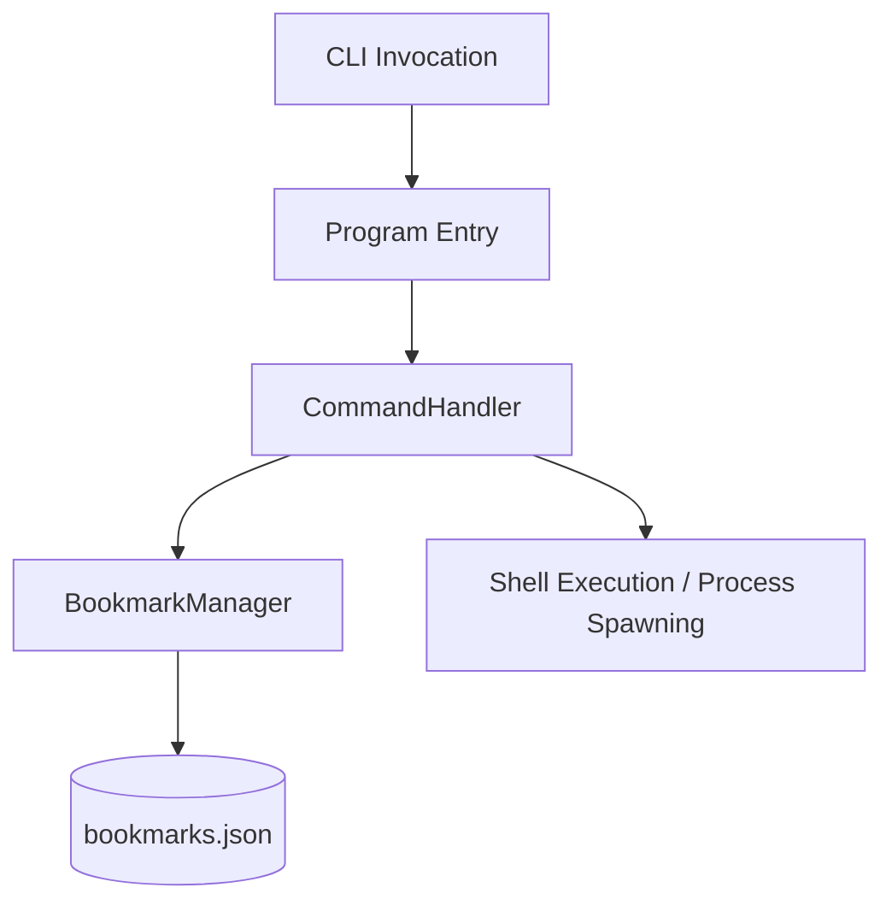

# Bookmark CLI

Bookmark is a small cross-platform .NET command-line utility for saving named shell commands and running them by alias. It stores the aliases as JSON beside the built executable and uses the operating system's command shell to execute a selected entry.

## Run it

### Prerequisites

- .NET 10 SDK

From the repository root, display the built-in usage:

```sh
dotnet run --project Bookmark/Bookmark.csproj -- help
```

Add a named command, list saved entries, run one by its key, or remove it:

```sh
dotnet run --project Bookmark/Bookmark.csproj -- add projects "cd /d C:\Projects && start cmd /K"
dotnet run --project Bookmark/Bookmark.csproj -- list
dotnet run --project Bookmark/Bookmark.csproj -- projects
dotnet run --project Bookmark/Bookmark.csproj -- remove projects
```

The saved value is an operating-system shell command: Windows uses `cmd.exe`, while macOS/Linux use `/bin/sh`. Adapt commands to the current shell and platform. The application creates `bookmarks.json` in `AppContext.BaseDirectory` (for `dotnet run`, this is the build output directory).

Build the CLI with:

```sh
dotnet build Bookmark.slnx
```

---

## Utility Overview

Bookmark provides three core operations:
1. **Register** a shell command under a short key or alias.
2. **List** saved key-command pairs or remove an entry.
3. **Execute** the command associated with a key in the current operating system's shell.

---

## Component Architecture

The application is structured into three decoupled layers: the entry-point driver, the command handling controller, and the persistence manager.



### 1. Entry Point
* **File**: [Program.cs](Bookmark/Program.cs)
* **Responsibility**: Parses raw command-line arguments (`args`) passed during execution. It extracts the command verb (e.g., `add`, `remove`, `list`, `help`) along with optional parameters (key and value), and immediately delegates execution control to the command handler.

### 2. Command Controller
* **File**: [CommandHandler.cs](Bookmark/CommandHandler.cs)
* **Responsibility**: 
  * Orchestrates user operations based on the input verbs.
  * Dispatches administrative tasks (adding, removing, and listing bookmarks) to the persistence manager.
  * Implements cross-platform shell execution logic to execute shell/terminal commands corresponding to a bookmark key.

### 3. Persistence Manager
* **File**: [BookmarkManager.cs](Bookmark/BookmarkManager.cs)
* **Responsibility**: Manages the life cycle of the bookmarked data. It is responsible for loading and saving the data structure to a persistent file location.

---

## Storage & Core Algorithms

### 1. Data Structure & Storage Format
* **In-Memory Representation**: Bookmarks are managed using a hash-map table structure represented by a C# generic `Dictionary<string, string>`. This guarantees $O(1)$ lookup times for bookmarks.
* **Persistent Format**: The key-value pairs are stored in standard JSON format in a file named `bookmarks.json`, located in the application's base directory ([`AppContext.BaseDirectory`](Bookmark/BookmarkManager.cs)).
* **Persistence Mechanism**: 
  * **Reads**: Reads are performed on-demand. If the JSON file does not exist, an empty dictionary is returned. Otherwise, standard JSON deserialization is used.
* **Writes**: Modifications (additions or deletions) update the in-memory dictionary and immediately write the serialized, indented JSON back to disk to ensure immediate persistence.

## Project layout

```text
Bookmark.slnx
└── Bookmark/
    ├── Program.cs          CLI entry point
    ├── CommandHandler.cs   Argument dispatch and shell process execution
    └── BookmarkManager.cs  JSON-backed alias storage
```

This repository contains one executable project and does not currently include an automated test project. Saved shell commands execute with the permissions of the current user.

### 2. Cross-Platform Shell Execution Algorithm
To ensure compatibility across operating systems, the shell execution engine determines the operating system environment at runtime:
1. **Windows Systems**: Spawn `cmd.exe` with the `/C` argument followed by the target command to run the command and terminate the child shell process.
2. **Unix/Linux/macOS Systems**: Spawn `/bin/sh` with the `-c` argument and the target command enclosed in double quotes.
3. The process is started synchronously using C# standard `Process.Start` API, blocking the host process (`WaitForExit`) until the invoked shortcut process completes execution.
