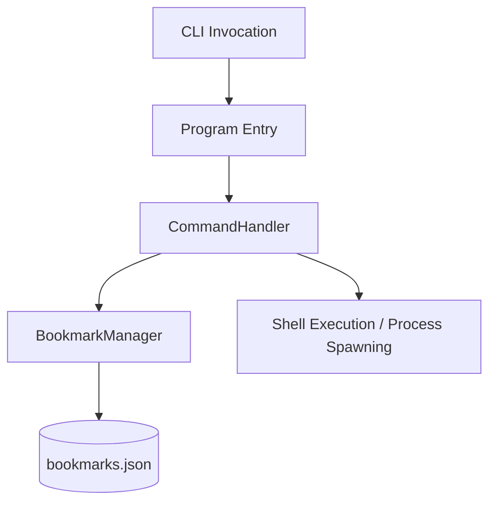

# Bookmark CLI - Architectural Overview

Bookmark is a cross-platform command-line utility designed to register, manage, and execute directory shortcuts or commands. This document outlines the utility's high-level architecture, component design, and storage mechanisms.

---

## Utility Overview

The primary goal of Bookmark is to serve as a fast command-line shortcut executor. It allows developers to:
1. **Register** shortcuts linking short keys/aliases to directory paths or terminal commands.
2. **Retrieve and List** currently registered shortcuts.
3. **Execute** commands or spawn shells directly in bookmarked paths across different operating systems.

---

## Component Architecture

The application is structured into three decoupled layers: the entry-point driver, the command handling controller, and the persistence manager.

### 1. Entry Point
* **File**: [Program.cs](file:///d:/PROYECTOS/bookmark/bookmark/Bookmark/Program.cs)
* **Responsibility**: Parses raw command-line arguments (`args`) passed during execution. It extracts the command verb (e.g., `add`, `remove`, `list`, `help`) along with optional parameters (key and value), and immediately delegates execution control to the command handler.

### 2. Command Controller
* **File**: [CommandHandler.cs](file:///d:/PROYECTOS/bookmark/bookmark/Bookmark/CommandHandler.cs)
* **Responsibility**: 
  * Orchestrates user operations based on the input verbs.
  * Dispatches administrative tasks (adding, removing, and listing bookmarks) to the persistence manager.
  * Implements cross-platform shell execution logic to execute shell/terminal commands corresponding to a bookmark key.

### 3. Persistence Manager
* **File**: [BookmarkManager.cs](file:///d:/PROYECTOS/bookmark/bookmark/Bookmark/BookmarkManager.cs)
* **Responsibility**: Manages the life cycle of the bookmarked data. It is responsible for loading and saving the data structure to a persistent file location.

---

## Storage & Core Algorithms

### 1. Data Structure & Storage Format
* **In-Memory Representation**: Bookmarks are managed using a hash-map table structure represented by a C# generic `Dictionary<string, string>`. This guarantees $O(1)$ lookup times for bookmarks.
* **Persistent Format**: The key-value pairs are stored in standard JSON format in a file named `bookmarks.json`, located in the application's base directory ([AppContext.BaseDirectory](file:///d:/PROYECTOS/bookmark/bookmark/Bookmark/BookmarkManager.cs#L7)).
* **Persistence Mechanism**: 
  * **Reads**: Reads are performed on-demand. If the JSON file does not exist, an empty dictionary is returned. Otherwise, standard JSON deserialization is used.
  * **Writes**: Modifications (additions or deletions) update the in-memory dictionary and immediately write the serialized, indented JSON back to disk to ensure immediate persistence.

### 2. Cross-Platform Shell Execution Algorithm
To ensure compatibility across operating systems, the shell execution engine determines the operating system environment at runtime:
1. **Windows Systems**: Spawn `cmd.exe` with the `/C` argument followed by the target command to run the command and terminate the child shell process.
2. **Unix/Linux/macOS Systems**: Spawn `/bin/sh` with the `-c` argument and the target command enclosed in double quotes.
3. The process is started synchronously using C# standard `Process.Start` API, blocking the host process (`WaitForExit`) until the invoked shortcut process completes execution.
